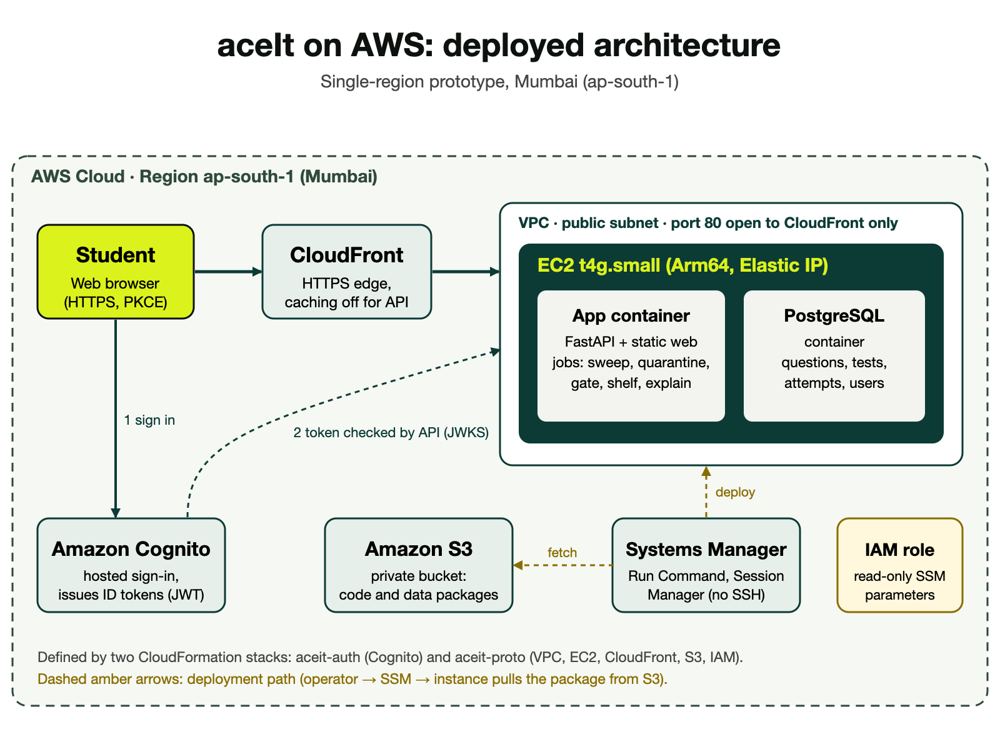

# aceIt: a free, autonomous GATE mock-test platform on AWS

Timed GATE Computer Science mock tests built from past papers, scored with the official marking rules (MCQ negative marking, multi-select, numerical ranges), with a clear analysis of where every mark went. Course project for **BCSE355L Cloud Architecture Design**, VIT Chennai.

**Live demo:** https://d10meumccwrsq5.cloudfront.net/ (sign up with an email address; no card, no ads)



## What is on AWS

| Piece | Service | Role |
|---|---|---|
| Edge | Amazon CloudFront | HTTPS in front of the app, caching off for the API |
| Compute | EC2 t4g.small (Arm64) | One host running two containers: FastAPI app and PostgreSQL |
| Identity | Amazon Cognito | Hosted sign-in (authorization code + PKCE); the API verifies the ID token |
| Packages | Amazon S3 (private) | Code and data packages used by deploys |
| Operations | Systems Manager | Run Command deploys and Session Manager, so no SSH port is open |
| Network | VPC, security group | Port 80 reachable only from CloudFront's managed prefix list |
| Config | CloudFormation | Two stacks: `aceit-auth` (Cognito) and `aceit-proto` (everything else) |

Region: `ap-south-1` (Mumbai). Design notes and decisions are in [`docs/system-design.md`](docs/system-design.md).

## Features

- Sprint, subject, topic and full-mock tests; timed exam console with palette, calculator, rough-work pad and pace indicator
- Scoring against the official answer keys; analysis of marks lost, time use and what to practise next
- Mistakes notebook, bookmarks and private notes, per-question explanations (written by an AI model and accepted only if they match the official answer)
- Automatic publish gate and quarantine rules, scheduled jobs under PostgreSQL advisory locks
- Privacy tools: download or erase your own data

## Repository layout

```
apps/api      FastAPI application, scheduled jobs, tests (pytest)
apps/web      Static single-page web app (ES modules), tests (node:test)
db            PostgreSQL schema, seed data and migrations
data          Syllabus taxonomy, topic tags and the test blueprint
infra         CloudFormation templates (Cognito, prototype stack) and sign-in page theme
deploy        Packaging and one-command update scripts with automatic rollback
tools         Ingestion tools for past papers (OCR, key import, taxonomy loading)
docs          System design document and architecture diagram
```

## Run the tests

```bash
cd apps/api && python -m venv .venv && .venv/bin/pip install -e . pytest && .venv/bin/python -m pytest tests -q   # needs PostgreSQL binaries
cd apps/web && node --test tests/
```

## Deploy to AWS

`infra/cognito.yaml` and `infra/prototype.yaml` create the stacks; `deploy/update.sh` ships a new version and rolls back by itself if the health check fails. See the design document for the exact commands.

## Not included

The official GATE question papers, their page images and answer-key extracts are third-party material and are **not** in this repository. The ingestion tools in `tools/` rebuild them locally from papers you download yourself.

## Authors

Ayush Raj (24BCE5026) and Aditya Sandhwar (24BCE5253), VIT Chennai.
